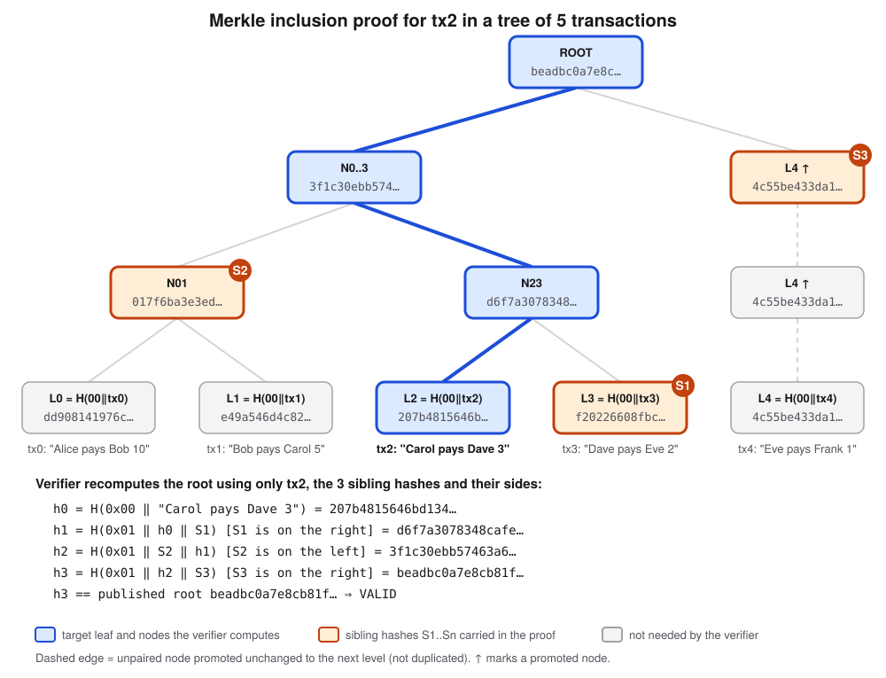

# Assignment 2 — Merkle Trees and Proofs of Inclusion (`merkle`)

**Roll:** 2611MC03 · **Stack:** Python 3.11+ (standard library only) · **Tests:** pytest

A Merkle-tree library (`merklelab`) and CLI (`merkle`) written from scratch. Only SHA-256 comes from
the standard library (`hashlib`); no Merkle-tree package is used

## 1. Setup

```bash
cd assign02
python3 -m venv .venv
source .venv/bin/activate            # Windows: .venv\Scripts\activate
pip install -e ".[test]"             # installs the `merkle` command + pytest
pytest -q                            # 114 tests
```

`pytest` also works without installing (tests import from `src/`). Without installing, the CLI is
`PYTHONPATH=src python -m merklelab ...`.

## 2. Tree specification

| Item | Rule |
|---|---|
| Hash | SHA-256 |
| Leaf hash | `H(0x00 ‖ data)` |
| Internal node | `H(0x01 ‖ left ‖ right)` |
| 0 leaves | root = `H("")` = `e3b0c442…b855` (no proofs possible) |
| 1 leaf | root = the leaf hash; proof has 0 siblings |
| Odd number of nodes on a level | the last, unpaired node is **promoted unchanged** to the next level |
| Leaf order | significant; leaf `i` is the `i`-th line of the input (0-based) |

Why these choices:
* **Domain separation (0x00 / 0x01)** means a 64-byte leaf can never be confused with an internal
  node, which blocks second-preimage attacks on the tree.
* **Promotion instead of duplication.** Bitcoin duplicates the last node, so `[a, b, c]` and
  `[a, b, c, c]` have the same root (CVE-2012-2459). Promotion keeps them different
  (`test_odd_leaves_promote_not_duplicate`).
* With these rules the tree is identical to **RFC 6962 (Certificate Transparency)**, so the code is
  checked against independently published reference roots (`vectors/rfc6962_roots.json`).

## 3. Proof format and verification

```json
{
  "leaf_index": 2,
  "tree_size": 5,
  "siblings": [
    {"side": "right", "hash": "f20226608fbc40f6a1b2fc6a82526ab5fe50bcbf6d3332d75b9ca60449a8287c"},
    {"side": "left",  "hash": "017f6ba3e3edaace7e8b73b523574b3d6dd2ef7a89eccc9f348b61a96c7a19ec"},
    {"side": "right", "hash": "4c55be433da1c1cf0d2b06549b7c15a8cac345269446b6add1dfa55931350c64"}
  ]
}
```

* Siblings go **from the leaf up to the root**.
* `side` is where the sibling sits: `left` → `h = H(0x01 ‖ sibling ‖ h)`, `right` → `h = H(0x01 ‖ h ‖ sibling)`.
* The verifier needs only the **leaf**, the **proof** and the **expected root**.

The correct number and direction of siblings is fully determined by `(leaf_index, tree_size)`, so the
verifier computes what the proof *must* look like and rejects anything else:

| Rejected input | Example file | Message / exit code |
|---|---|---|
| Malformed hash (not 64 lowercase hex) | `examples/bad_hash.json` | `malformed hash` · 2 |
| Invalid direction (not `left`/`right`) | `examples/bad_direction.json` | `invalid direction` · 2 |
| Wrong index (out of range, or directions don't fit the index) | `examples/bad_index.json` | `wrong index` · 2 |
| Unnecessarily long proof (padding) | `examples/bad_long.json` | `proof too long` · 2 |
| Too short, missing/extra/duplicate keys, non-integer index | tests | 2 |
| Tampered sibling, wrong leaf, wrong root | `examples/bad_tampered_sibling.json` | `root mismatch` · 1 |

Exit codes: `0` valid · `1` well-formed but does not lead to the root · `2` malformed input.

## 4. Commands

```bash
merkle root   examples/txs5.txt                         # tree_size, depth, root
merkle prove  examples/txs5.txt --index 2 -o proof.json # inclusion proof (stdout without -o)
merkle verify --leaf "Carol pays Dave 3" --proof proof.json \
              --root beadbc0a7e8cb81f2f78ea36716ba690dc8791a32254bda9ab26de5c3df96568
merkle tree   examples/txs5.txt --index 2               # print all levels, mark the proof path
merkle bench  --sizes 8,1024,100000                     # performance table
```

Leaf files: one leaf per line, UTF-8, LF line endings (a final newline is optional; CR is rejected so
Windows line endings can't silently change leaves). `--hex` treats each line as hex bytes;
`--leaf-hex` does the same for `verify`. `-` reads from stdin.

## 5. Deliverables

| Deliverable | Where |
|---|---|
| Library | `src/merklelab/tree.py` (construction), `src/merklelab/proof.py` (proofs, JSON, verify) |
| CLI `root`, `prove`, `verify` (+ `tree`, `bench`) | `src/merklelab/cli.py` |
| Test vectors | `vectors/rfc6962_roots.json` (published RFC 6962 roots, 0–8 leaves), `vectors/five_tx.json` (all levels and all 5 proofs) |
| Tests (114) | `tests/` — 0/1/odd/even sizes, every proof for sizes 1–33 and 100–1000, every rejection case, CLI |
| Performance report | `docs/performance.md` — 8, 1,024, 100,000 and 1,000,000 leaves |
| Proof-path diagram (5 transactions) | `docs/proof_path_5tx.svg` / `.png`, regenerate with `python scripts/diagram.py` |



### Performance summary (full report in `docs/performance.md`)

| Leaves | Build time | Max siblings | Max proof hashes | Avg proof JSON |
|---:|---:|---:|---:|---:|
| 8 | 0.01 ms | 3 | 96 B | 331 B |
| 1,024 | 0.74 ms | 10 | 320 B | 997 B |
| 100,000 | 86 ms | 17 | 544 B | 1,658 B |
| 1,000,000 | 925 ms | 20 | 640 B | 1,946 B |

Build time grows linearly; proof size grows with log₂ n.

## 6. Layout

```
assign02/
├── readme.md · pyproject.toml · requirements.txt · DEMO_SCRIPT.md
├── src/merklelab/   tree.py · proof.py · cli.py · bench.py
├── tests/           test_tree.py · test_proof.py · test_cli.py · test_vectors.py
├── vectors/         rfc6962_roots.json · five_tx.json
├── docs/            performance.md · proof_path_5tx.svg · proof_path_5tx.png
├── scripts/         diagram.py
└── examples/        txs5.txt · bad_*.json (rejected proofs for the demo)
```
