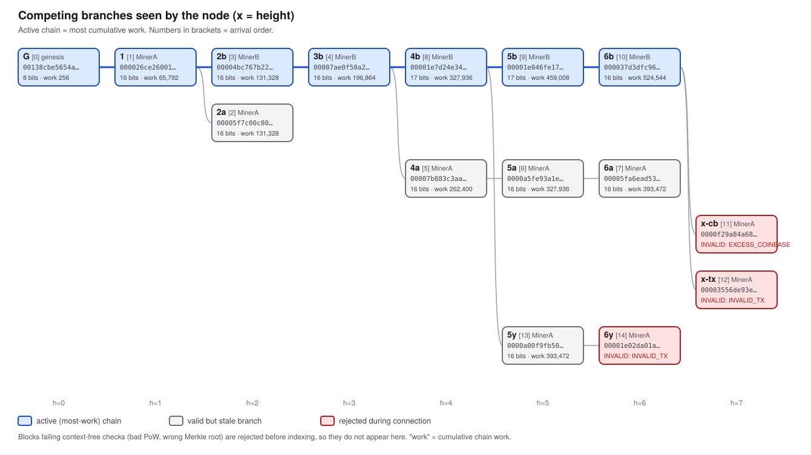

# Assignment 5 — Blocks, Proof of Work, Forks, and Reorganisation (`chain`)

**Roll:** 2611MC03 · **Stack:** Python 3.11+ · `cryptography` (signatures) · pytest

Turns the Assignment 4 transaction validator into a chain. It adds block headers with toy proof of work,
full block validation, most-work chain selection, and reorganisation with exact restoration of spent
outputs. **The full report is `docs/report.md`.** It contains the header hex dump, the branch diagram, the
simulation results & the measurements.

## 1. Setup

```bash
cd assign05
python3 -m venv .venv
source .venv/bin/activate            # Windows: .venv\Scripts\activate
pip install -e ".[test]"
pytest -q                            # 33 tests
chain simulate --out examples/fork_sim
```

## 2. What's implemented

| Task | Where |
|---|---|
| 1. Header: version, prev hash, Merkle root, timestamp, target, nonce (116 bytes) | `src/chainlab/block.py` |
| 2. Mining: vary the nonce until `int(SHA256(SHA256(header))) ≤ target` | `block.mine()`, `chain mine` |
| 3. Validation: header, PoW, Merkle root, tx sequence, coinbase rules, all state transitions | `chain.check_block()`, `Chain.submit()`, `_apply_block()` |
| 4. Cumulative work; the active chain is the valid chain with the **most work** (not the most blocks) | `Chain._activate_best()` |
| 5. Reorg: disconnect old blocks, **restore spent outputs** from undo data, connect the winning branch; roll back if the new branch is invalid | `Chain._reorg_to()`, `_disconnect()` |
| 6. Two miners producing competing blocks, fork resolved | `chain simulate` (`src/chainlab/sim.py`) |
| 7. Hashes/s and expected vs observed attempts at three toy targets | `chain measure` (`src/chainlab/measure.py`) |

Rules in brief: subsidy 50 + fees per block; the coinbase is the first tx (null outpoint, index = height);
timestamps must exceed the median of the last 11 blocks and be at most 2 h in the future; targets must
lie in [1, 2²⁴⁸−1]. Each block declares its own target (a toy simplification, explained in the report).

## 3. Commands

```bash
chain keygen   --name minerA
chain init     --data node.json --give <ADDR>:40 --give <ADDR>:70      # genesis
chain pay      --data node.json --key keys/alice.key.json --to <ADDR> --amount 85 --fee 2   # into mempool
chain mine     --data node.json --key keys/minerA.key.json --bits 16    # mine on the tip
chain mine     --data node.json --key keys/minerB.key.json --bits 16 --parent 1 -o b.json   # fork from height 1
chain submit   --data node.json --block b.json                          # block from elsewhere
chain tree     --data node.json                                         # every branch, work, status
chain show     --data node.json --block 1                               # header hex dump
chain status   --data node.json
chain simulate --out examples/fork_sim
chain measure  --bits 12,16,20 --blocks 300,40,5
```

## 4. Acceptance checks

| Check | Evidence |
|---|---|
| Longer lower-work branch loses to shorter higher-work branch | simulation: 3 × 16-bit (height 6) loses to 2 × 17-bit (height 5); `test_longer_lower_work_branch_loses` |
| Invalid PoW / wrong Merkle root / excess coinbase / invalid tx → whole block rejected, active chain unchanged | simulation blocks x-pow, x-mrk, x-cb, x-tx; tests compare tip, active list and UTXO-set hash before and after |
| Reorg produces the correct final UTXO set | after every reorg the UTXO-set hash equals a fresh replay of the active chain from genesis |

## 5. Deliverables

| Deliverable | Where |
|---|---|
| Node-local chain manager | `src/chainlab/chain.py` |
| Miner command | `chain mine` |
| Fork simulation | `chain simulate` → `examples/fork_sim/fork_log.md`, `node.json` |
| Reorganisation tests | `tests/test_chain.py` |
| Report with header hex dump and diagram of competing branches | `docs/report.md`, `examples/fork_sim/header_dump.txt`, `examples/fork_sim/fork_diagram.svg/.png` |
| Measurements | `examples/measurements.md` |



## 6. Layout

```
assign05/
├── readme.md · pyproject.toml · requirements.txt · DEMO_SCRIPT.md · .gitignore
├── src/chainlab/  block.py · chain.py · state.py · sim.py · measure.py · report.py · cli.py
│                  tx.py · wallet.py · crypto.py · base58.py   (from Assignment 4)
├── tests/         test_block.py · test_chain.py · test_cli_sim.py
├── docs/          report.md
└── examples/      fork_sim/ (log, diagram, header dump, node) · measurements.md
```
