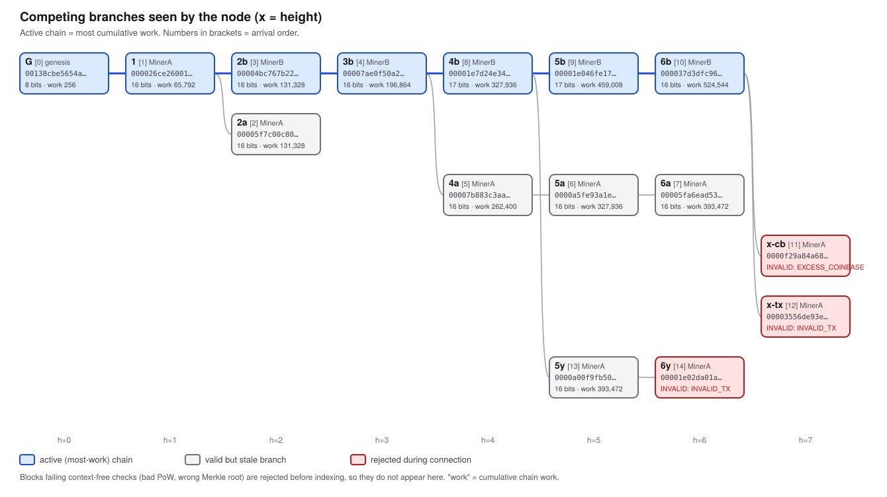

# Assignment 5 — Report: Blocks, Proof of Work, Forks, and Reorganisation

**Roll:** 2611MC03

All numbers below come from `chain simulate --out examples/fork_sim` and
`chain measure --bits 12,16,20 --blocks 600,120,30 --md examples/measurements.md`.
Both commands are deterministic (fixed keys and timestamps), so rerunning them reproduces the same
blocks and hashes. Only the hash rate depends on the machine.

## 1. Block header

| Offset | Size | Field | Encoding |
|---:|---:|---|---|
| 0 | 4 | version | u32 big-endian, must be 1 |
| 4 | 32 | prev_hash | hash of the parent header |
| 36 | 32 | merkle_root | root over the block's txids (Assignment 2 tree: leaf `H(0x00‖txid)`, node `H(0x01‖l‖r)`, odd node promoted) |
| 68 | 8 | timestamp | u64 Unix seconds |
| 76 | 32 | target | full 256-bit target |
| 108 | 8 | nonce | u64; the miner varies it |
| | **116** | | block hash = SHA-256(SHA-256(header)) |

**Proof of work:** `int(block_hash) ≤ target`, read as an unsigned big-endian integer.
**Work of a block:** ⌊2²⁵⁶ / (target + 1)⌋ = 2^bits for our targets. **Chain work:** the sum from genesis.

### Header hex dump (block 1 of the simulation)

```
 off len  field        hex
   0   4  version      00000001   (1)
   4  32  prev_hash    00138cbe5654a3a6a8084771edea22f3b5ff23b57eccf73937b3a2b4455b3316
  36  32  merkle_root  188d0d641b7d947354e40178b4eb227fee6b6e65195fe40374eb010e5e99db2b
  68   8  timestamp    000000006955bb58   (2026-01-01 00:10:00 UTC)
  76  32  target       0000ffffffffffffffffffffffffffffffffffffffffffffffffffffffffffff   (16 leading zero bits)
 108   8  nonce        0000000000033920   (211,232)

header bytes (116):
00000001 00138cbe5654a3a6a8084771edea22f3b5ff23b57eccf73937b3a2b4455b3316
188d0d641b7d947354e40178b4eb227fee6b6e65195fe40374eb010e5e99db2b 000000006955bb58
0000ffffffffffffffffffffffffffffffffffffffffffffffffffffffffffff 0000000000033920

block hash = SHA256(SHA256(header)) = 000026ce260011145a437057b7ac8ffc3de1fa0ebcf567eae14f999e7b74bf29
hash <= target ? True   work = 65,536
```

The hash begins with 16 zero bits (`0000…`), as the target requires. The miner tried nonces 0 to 211,232,
so this block took 211,233 attempts, about 3.2× the expected 65,536. That is unlucky but normal for a
geometric distribution. Any CLI block can be dumped the same way with `chain show --data node.json --block <height>`.

## 2. Consensus rules

| Stage | Rule | Rejection code |
|---|---|---|
| context-free | target in [1, POW_LIMIT = 2²⁴⁸−1] | `BAD_TARGET` |
| | hash ≤ target | `BAD_POW` |
| | 1–1000 transactions; the first is the coinbase, no other is | `BAD_TX_COUNT`, `BAD_COINBASE` |
| | no duplicate transaction | `DUPLICATE_TX` |
| | merkle_root matches the transactions | `BAD_MERKLE_ROOT` |
| contextual | parent known (otherwise held as an orphan) and not invalid | `INVALID_PARENT` |
| | coinbase input index = block height (makes coinbase txids unique) | `BAD_COINBASE_HEIGHT` |
| | timestamp > median of the previous 11; ≤ now + 2 h | `TIME_TOO_OLD`, `TIME_TOO_NEW` |
| state (on connect) | every transaction valid in order (Assignment 4 rules; may spend outputs of earlier txs in the same block) | `INVALID_TX` (with the inner reason) |
| | coinbase total ≤ subsidy (50) + fees of the block | `EXCESS_COINBASE` |

A block is connected **all or nothing**. Transactions are applied one by one with undo records, and any
failure rolls back the ones already applied before the error is reported.

**Toy simplification:** each block declares its own target (within `POW_LIMIT`), and work is credited from
that target. A real chain derives the target from a retargeting rule. This shortcut lets the simulation
build "fewer but harder" blocks without hours of mining, and the fork choice is still most-work. There is
no coinbase maturity: coinbase outputs can be spent in the next block.

## 3. Chain selection and reorganisation

* Every block is stored in an index with its height and **cumulative work**. The active chain ends at the
  valid block with the **most cumulative work**. Ties keep the block seen first.
* **Connect** validates the block against the current UTXO set and records undo data: the exact
  (outpoint, output) pairs it spent, and the outpoints it created.
* **Disconnect** removes the created outputs and **restores the spent outputs** from the undo data.
* **Reorganisation:** find the fork point, disconnect active blocks back to it (newest first), and connect
  the new branch (oldest first). Transactions from disconnected blocks that are not in the new branch
  return to the mempool if still valid; conflicting ones are dropped.
* **Failed reorganisation:** if any block of the new branch fails, it and its descendants are marked
  invalid. The partially connected blocks are disconnected and the old chain is reconnected, so the active
  chain and UTXO set end exactly as they began. The node then considers the next-best valid branch.

## 4. Fork simulation

Two miners. Miner A and Miner B both build on the node's view. Genesis gives Alice 40 + 70 and Bob 50;
the subsidy is 50.



| Block | Miner | Bits | What happens | Result |
|---|---|---:|---|---|
| 1 | A | 16 | Alice pays Bob 85 | CONNECTED |
| 2a | A | 16 | Bob pays Carol 100 | CONNECTED |
| 2b | B | 16 | **conflicting** Bob pays Dave 60, same parent, equal work | SIDE_BRANCH (first seen kept) |
| 3b | B | 16 | extends 2b → more work | **REORG**: disconnect 2a, connect 2b, 3b; Bob→Carol dropped as conflicting |
| 4a, 5a, 6a | A | 16 each | three easy blocks; work 3 × 65,536 = 196,608 | CONNECTED (height 6) |
| 4b | B | 17 | one harder block; 131,072 < 196,608 | SIDE_BRANCH |
| 5b | B | 17 | 2 × 131,072 = 262,144 > 196,608 | **REORG** to height **5**, beating height **6**; Dave→Carol returns to the mempool |
| 6b | B | 16 | mines Dave→Carol from the mempool | CONNECTED |
| x-pow | A | 16 | nonce changed after mining | REJECTED `BAD_POW` |
| x-mrk | A | 16 | transaction added after mining | REJECTED `BAD_MERKLE_ROOT` |
| x-cb | A | 16 | coinbase pays 51 > 50 | REJECTED `EXCESS_COINBASE` |
| x-tx | A | 16 | contains an already-spent transaction | REJECTED `INVALID_TX (DOUBLE_SPEND)` |
| 6y | A | 19 | arrives before its parent | ORPHAN |
| 5y | A | 16 | parent arrives; branch 4b→5y→6y would have work 917,760 > 524,544 | SIDE_BRANCH, then 6y processed |
| 6y | A | 19 | reorg attempted, 6y fails to connect | REJECTED `INVALID_TX`, **rolled back** to 6b |

Final active chain: **G → 1 → 2b → 3b → 4b → 5b → 6b**. Balances: Alice 23, Bob 74, Carol 30, Dave 29,
MinerA 52, MinerB 252. Full log: `examples/fork_sim/fork_log.md`.

## 5. Acceptance checks

| Requirement | Evidence |
|---|---|
| A longer but lower-work branch loses to a shorter higher-work branch | Simulation 4a–6a vs 4b–5b; `test_longer_lower_work_branch_loses` (3 × 9-bit vs 2 × 10-bit) |
| Invalid PoW, incorrect Merkle root, excess coinbase or an invalid transaction rejects the entire block without changing the active chain | Simulation x-pow / x-mrk / x-cb / x-tx (tip and UTXO-set hash compared before and after); `test_invalid_pow`, `test_incorrect_merkle_root`, `test_excess_coinbase`, `test_invalid_transaction_rejects_whole_block` (the valid tx in the bad block is **not** applied) |
| A reorganisation produces the correct final UTXO set | After every reorg the node's UTXO-set hash equals a **fresh replay of the active chain from genesis** (simulation final check; `test_reorg_restores_spent_outputs_and_matches_replay`; `test_many_reorgs_end_in_correct_utxo_set` checks this after each of 12 random forks) |
| Reorg through an invalid block | 6y in the simulation; `test_invalid_block_inside_heavier_branch_rolls_back` |

## 6. Hash rate and expected vs observed attempts

| Target | Leading zero bits | Blocks | Expected attempts | Observed mean | Observed / expected | Expected noise (1 s.e.) | Min – max | Hash rate |
|---|---:|---:|---:|---:|---:|---:|---:|---:|
| `000fffffffff…` | 12 | 600 | 4,096 | 4,149 | 1.01 | ±4% | 4 – 46,395 | 1,356,060 H/s |
| `0000ffffffff…` | 16 | 120 | 65,536 | 67,276 | 1.03 | ±9% | 527 – 358,761 | 1,384,921 H/s |
| `00000fffffff…` | 20 | 30 | 1,048,576 | 832,352 | 0.79 | ±18% | 8,503 – 3,143,144 | 1,415,687 H/s |

Overall **≈ 1.40 million hashes/s**: one Python thread hashing a 116-byte header twice with SHA-256. The
first SHA-256 state over the 108 fixed bytes is reused for every nonce.

**Interpretation.**
* Each attempt succeeds with probability *p* = (target+1)/2²⁵⁶ = 2^−bits, so attempts follow a
  **geometric distribution** with mean 1/*p*. Its standard deviation is about equal to the mean, which is
  why single blocks range from a handful of attempts to more than 3× the mean.
* The average of *n* blocks has a standard error of about mean/√*n*. The 12- and 16-bit results are within
  1 s.e. of expectation. The 20-bit result (0.79) is about 1.2 s.e. low, which is not significant at 30
  samples. The geometric distribution is skewed: its median is only about 0.69 × the mean, so small
  samples more often come out below the mean than above.
* Each extra bit doubles the expected work. At this hash rate a 20-bit block takes about 0.75 s on
  average, and a 32-bit block would take about 50 min. This is why the chain uses toy targets, and why
  real miners use specialised hardware.

## 7. Reproduce

```bash
chain simulate --out examples/fork_sim
chain measure --bits 12,16,20 --blocks 600,120,30 --md examples/measurements.md   # ~25 s here; slower in Codespaces
pytest -q
```
