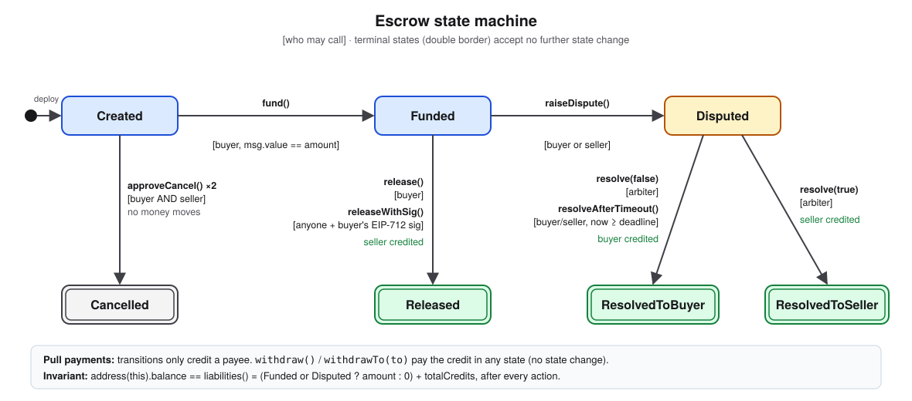

# Assignment 7 — Solidity Escrow from Specification to Deployment

**Roll:** 2611MC03 · **Stack:** Solidity 0.8.38 · Foundry (forge, anvil, cast) · OpenZeppelin 5.7

An escrow for a buyer, a seller and an arbiter. The buyer funds it. The buyer releases payment, or either
party disputes & the arbiter decides. Both parties can cancel before funding. All payouts are pull
payments.

## 1. Run the tests (one command)

```bash
cd assign07
forge test
```

- **Result:** 56 tests: unit, fuzz (1000 runs each) and invariant (256 runs × 50 calls).
- **No install step:** `forge-std` and the three OpenZeppelin components are vendored in `lib/` (see
  `lib/VENDORED.md`), so a clean checkout needs nothing but Foundry.
- **Compiler:** Foundry downloads solc 0.8.38 automatically on the first run.

### Installing Foundry (once)

```bash
curl -L https://foundry.paradigm.xyz | bash
source ~/.bashrc        # or open a new terminal
foundryup
forge --version
```

If that site is unreachable, npm works too: `npm install -g @foundry-rs/forge @foundry-rs/anvil @foundry-rs/cast`.

## 2. Deploy to a local Anvil node and interact (script, not a GUI)

```bash
python3 script/run_local.py
```

The script:
1. Starts Anvil if none is running.
2. Deploys four escrows with `forge script script/Deploy.s.sol`.
3. Drives every path with `cast send` from the correct account:
   - **happy:** fund → release → withdraw
   - **dispute:** fund → dispute → arbiter resolves → withdraw
   - **cancel:** buyer and seller both approve
   - **signed:** fund → a relayer submits the buyer's EIP-712 signature (made with `cast wallet sign`) → withdraw
4. Verifies emitted events, `balance == liabilities()` after every transaction, exact final balances of
   every account, gas used, and the deployed bytecode at each address.

Outputs:
- `deployments/anvil/summary.md`: report with addresses, tx hashes, gas, events, balances and 34 checks
- `deployments/anvil/receipts/*.json`: raw receipts
- `deployments/<label>.json`: deployment records

Deploying a single escrow by hand:

```bash
anvil --hardfork osaka &
BUYER=0x70997970C51812dc3A010C7d01b50e0d17dc79C8 \
SELLER=0x3C44CdDdB6a900fa2b585dd299e03d12FA4293BC \
ARBITER=0x90F79bf6EB2c4f870365E785982E1f101E93b906 LABEL=mine \
forge script script/Deploy.s.sol --rpc-url http://127.0.0.1:8545 --broadcast \
  --private-key 0xac0974bec39a17e36ba4a6b4d238ff944bacb478cbed5efcae784d7bf4f2ff80
```

These are Anvil's public development accounts (#1–#3, key #0), for local testing only.

`Deploy.s.sol` refuses any chain other than Anvil (31337) unless `ALLOW_NON_LOCAL=true`.

## 3. Deliverables

| Deliverable | Where |
|---|---|
| Concise specification (written first) | `docs/specification.md` |
| Solidity contract | `src/Escrow.sol` |
| Tests: every transition and every rejected transition | `test/Escrow.t.sol` (37) |
| Fuzz tests: deposited amounts and caller roles | `test/EscrowFuzz.t.sol` (4 × 1000 runs) |
| Invariants: balance == liabilities after every action, conservation, no unauthorised credit | `test/EscrowInvariant.t.sol` |
| Reentrancy, rejecting payee, EIP-712 replay/forgery | `test/EscrowSecurity.t.sol` (11) |
| Deployment and interaction scripts | `script/Deploy.s.sol`, `script/run_local.py` |
| State-machine diagram | `docs/state-machine.md` / `.png` / `.svg` |
| Local transaction receipts | `deployments/anvil/receipts/`, `deployments/anvil/summary.md` |
| Gas report | `docs/gas-report.md`, `.gas-snapshot` |
| Threat model | `docs/threat-model.md` |



## 4. Design in brief

- **States:** Created → Funded | Cancelled; Funded → Released | Disputed; Disputed → ResolvedToBuyer |
  ResolvedToSeller. Terminal states revert every state-changing call with `InvalidState`.
- **Custom errors** for every rejection, and **events** for every transition (`StateChanged` plus a
  specific event).
- **Checks-effects-interactions + pull payments:** transitions only credit, `withdraw` zeroes the credit
  before the single checked `call`, and the function is `nonReentrant`.
- **Prevented:**
  - zero addresses and role overlap (constructor)
  - repeated or wrong-amount funding
  - unauthorised transitions
  - reentrancy
  - stray ETH (`receive`/`fallback` revert)
  - locked funds: a dispute timeout refunds the buyer if the arbiter vanishes, and `withdrawTo` serves
    payees that cannot receive ETH
- **Acceptance checks:** balance and liabilities agree after every tested action (unit asserts, fuzz,
  invariant and the Anvil run); unauthorised users cannot redirect funds; terminal states cannot pay
  twice; the full suite runs with `forge test`.
- **Stretch goals (both done):** EIP-712 gas-sponsored release (`releaseWithSig`) and a time-bounded
  recovery path (`resolveAfterTimeout`). Trust and replay assumptions are in the threat model.
- **Avoided:** `tx.origin`, loops, timestamp equality, unchecked low-level calls, admin keys.

## 5. Layout

```
assign07/
├── foundry.toml · readme.md · DEMO_SCRIPT.md · .gas-snapshot · .gitignore
├── src/Escrow.sol
├── test/        Base.t.sol · Escrow.t.sol · EscrowFuzz.t.sol · EscrowInvariant.t.sol · EscrowSecurity.t.sol
├── script/      Deploy.s.sol · run_local.py
├── docs/        specification.md · state-machine.md/.png/.svg · threat-model.md · gas-report.md
├── deployments/ anvil/summary.md · anvil/receipts/*.json · *.json
└── lib/         forge-std (v1.17.0) · openzeppelin-contracts (v5.7.0, used files only) · VENDORED.md
```
