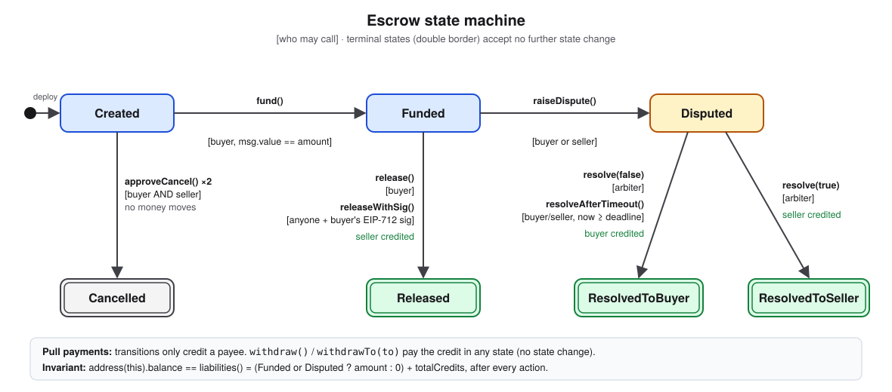
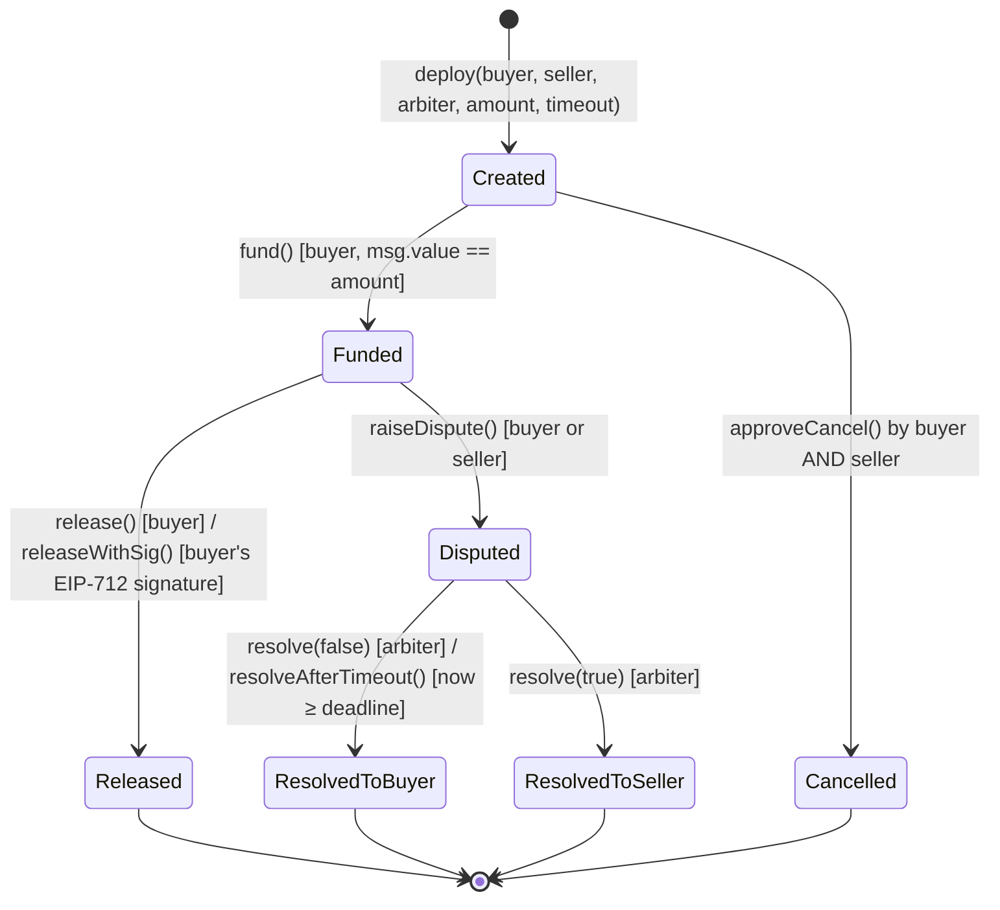

# Escrow — State Machine

The same diagram as Mermaid:

| State | Contract holds | Who can be credited next | Terminal |
|---|---|---|---|
| Created | 0 | — | no |
| Funded | `amount` | seller (release) | no |
| Disputed | `amount` | buyer or seller (arbiter / timeout) | no |
| Released | credit of seller until withdrawn | — | **yes** |
| ResolvedToBuyer | credit of buyer until withdrawn | — | **yes** |
| ResolvedToSeller | credit of seller until withdrawn | — | **yes** |
| Cancelled | 0 | — | **yes** |
